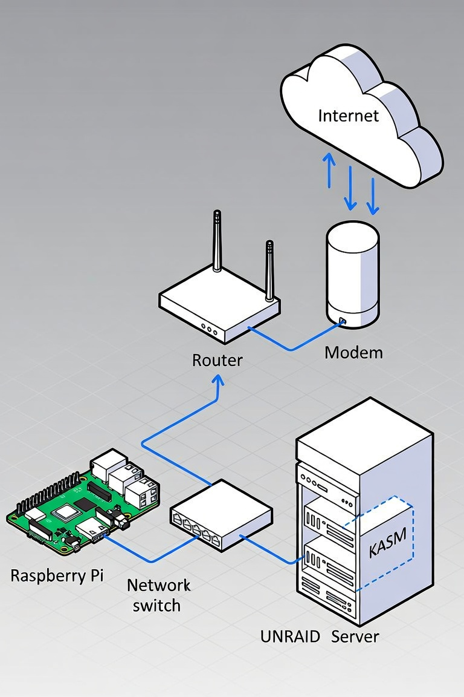

<!--
  THIN-SLICE-OF-RASPBERRY-PI · Obsidian Forged Systems
  Cyber-Physical Systems · Self-Hosted Infrastructure · Zero-Touch Edge Clients
-->

<div align="center">
  
</div>

<br/>

<p align="center">
  
  
  
  
  
</p>

---

## Abstract

Young children need supervised, filtered computer access, but consumer devices assume an operator who can log in, dismiss dialogs, and recover from errors — and client-side parental controls are fragile, bypassable, and scattered across devices. This project implements a zero-touch thin-client architecture: a Raspberry Pi running a single-application Wayland compositor (`cage`) boots directly into a Chromium kiosk attached to a containerized browser session on a self-hosted UNRAID Kasm Workspaces server — in **persistent mode**, the kiosk is bound to one child's Kasm user via the Developer API (`get_login`), so her bookmarks, files, and settings survive reboots and session stops in a server-side persistent profile; in **cast mode**, an anonymous casting URL yields a factory-fresh disposable session every boot. All rendering, state, and content filtering live server-side with no bypassable policy on the client, and a health-gated, self-restarting systemd service makes the kiosk recover autonomously from crashes, network races, and power loss. The system is fully self-hosted with no cloud dependency or recurring licensing, and the entire client is reproducible from this repository with one idempotent provisioning script. Deployed and in daily family use: cold boot to live filtered session in under 60 seconds with zero user interaction.

> **Design intent:** A computer a child can operate and cannot break — power on, wait, use. Her stuff lives on the server, so a reboot fixes everything and loses nothing.

---

## Project Dashboard

<div align="center">

| Metric | Target | Current | Δ |
|:-------|:------:|:-------:|:--:|
| **Schedule** — v2.0 re-provision | Complete | Complete | ON_TRACK |
| **Budget / BOM Cost** (per kiosk, excl. display) | $100 | ~$85 | −$15 |
| **Boot-to-session time** (cold boot, wired) | ≤ 60 s | PENDING v2 measurement | — |
| **Server RAM per session** | ≤ 2 GB | ~1.5 GB | −0.5 GB |
| **Test Coverage / V&V** (F1–F8 matrix) | 8/8 | PENDING v2 run | — |
| **Open Risks (High, score ≥ 12)** | 0 | 0 | — |

</div>

---

## Scope & Objectives

**In scope**

- Boot a Raspberry Pi to a live, filtered browser session in ≤ 60 s with zero user interaction, and with no credential the child can extract or use beyond her own login
- Auto-recover from browser crash (≤ 10 s), boot-before-network race, session expiry, and power loss without adult intervention
- Enforce all content policy (SafeSearch, category/allow-list filtering, session limits) server-side, unbypassable and unmodifiable from the kiosk
- Replicate any kiosk from a blank SD card in ≤ 30 min using one idempotent provisioning script
- Bind each kiosk to one child: bookmarks, saved files, and settings persist across reboots and session stops (persistent profile), with exact-tab session reattach inside the idle window

**Explicitly out of scope**

- Internet exposure of the Kasm instance; this is a LAN-only system by design
- Non-browser workloads (games, local apps) on the kiosk itself

**Success criteria** — the project is *done* when: a child powers on the kiosk unassisted and reaches *her own* filtered browsing session with her state intact, and every fault in the F1–F11 matrix self-recovers or is fixed by a power cycle.

---

## System Architecture

```text
┌─────────────────┐     ┌──────────────────┐     ┌──────────────────┐
│  RASPBERRY PI    │────▶│  KASM WORKSPACES │────▶│  SESSION          │
│  THIN CLIENT     │     │  ORCHESTRATION   │     │  CONTAINER        │
│  cage + Chromium │◀────│  (UNRAID/Docker) │◀────│  (filtered        │
│  --kiosk         │     │  Casting + Auth  │     │   browser)        │
└─────────────────┘     └──────────────────┘     └──────────────────┘
        │                        │                        │
        ▼                        ▼                        ▼
  HTTPS 443 → cast URL     DinD container mgmt      KasmVNC/WebSocket
  (LAN only, egress-       + Web Filter Policy      video/input stream
   restricted VLAN)          (server-side)            back to client
```

| Layer | Component | Interface / Protocol | Notes |
|:------|:----------|:---------------------|:------|
| Client | Raspberry Pi OS Lite 64-bit, `cage`, `chromium-browser` | HDMI out, USB HID in, Ethernet | Stateless; SD card is disposable; no desktop underneath the browser |
| Client boot gate | `wait-for-kasm.sh` → systemd `ExecStartPre` | HTTPS GET `/api/__healthcheck` | Eliminates boot-before-network race; `Restart=always` retries forever |
| Session entry (persistent) | Kasm Developer API `get_login` | `POST /api/public/get_login` → per-user login URL | Auto-login as the kiosk's bound user; key scoped to `Users Auth Session` only |
| Session entry (cast) | Kasm Session Casting (anonymous) | `https://<host>:<port>/#/cast/<key>` | Stateless variant; IP-restricted to kiosk subnet |
| State | Persistent profile `/profiles/{username}` on UNRAID share | Bind mount into session container | The child's "computer"; include in server backups |
| Orchestration | Kasm Workspaces 1.18.x, single-container (DinD) | Docker on UNRAID | Pinned tag; spawns one container per session |
| Session | `kasmweb/chrome` workspace container | KasmVNC over WebSocket/443 | 2 cores / 1.5–2 GB; Web Filter Policy applied here — kiosk cannot touch it |
| Network | Kiosk VLAN → server, single-port allow | 443/TCP only | All other kiosk egress denied at the firewall |

---

## Dependencies & Environment

### Runtime / Software

| Dependency | Version | Purpose | Pinned? |
|:-----------|:-------:|:--------|:-------:|
| Kasm Workspaces | 1.18.0 | Session orchestration, casting, filtering | ✅ |
| Raspberry Pi OS Lite | Debian 12 (Bookworm), 64-bit | Kiosk OS | ✅ |
| cage | Bookworm repo | Single-app Wayland kiosk compositor | ✅ (distro) |
| chromium-browser | Bookworm repo | Kiosk browser (Wayland/Ozone) | ⚠️ floating (distro updates) |
| Docker (UNRAID) | UNRAID-managed | Kasm host runtime | ✅ |
| seatd | Bookworm repo | Seat management for unprivileged kiosk user | ✅ (distro) |
| jq | Bookworm repo | Parse Kasm API responses (persistent mode) | ✅ (distro) |

### Hardware / Physical

| Item | Spec | Qty | Source | Notes |
|:-----|:-----|:---:|:-------|:------|
| Raspberry Pi | 3B+ / 4 / 5, 64-bit capable | 1 per kiosk | CanaKit et al. | Rendering is server-side; Pi 3B+ is sufficient |
| microSD | 16 GB+, A1/A2, endurance-rated | 1 per kiosk | SanDisk/Samsung | Disposable; overlay FS after burn-in |
| PSU | Official Pi supply | 1 per kiosk | — | Undervoltage = flaky kiosk |
| Display + HID | Any HDMI monitor, USB kbd/mouse | 1 set | — | Cap at 1080p on Pi 3 |
| Server | ≥ 2 GB RAM + 2 cores **per concurrent session** | 1 | Existing UNRAID host | Headroom = (kiosks + 1) × 2 GB |
| Ethernet run | Cat5e+ to kiosk location | 1 | — | Strongly preferred over Wi-Fi (boot timing) |

### Environmental Requirements

- **Power:** 5 V/3 A per kiosk (≤ 15 W); server per existing UNRAID budget
- **Network:** LAN-only; ~5–15 Mbps per active session for KasmVNC at 1080p; fully functional with WAN down (local sites/filtering excepted)
- **Thermal / Enclosure:** passive-cooled Pi case; indoor ambient
- **Security posture:** no outbound calls from the kiosk except the Kasm host; casting URL IP-restricted; no credentials at rest on the client; all policy server-side

---

## Milestones & Roadmap

| ID | Milestone | Exit Criteria | Trigger | Status |
|:--:|:----------|:--------------|:------:|:------:|
| M1 | Server config (Kasm 1.18, casting, filtering) | Cast URL passes zero-prompt acceptance test from a laptop ([docs/01 §7](docs/01-server-setup.md)) | v2.0 rebuild | 🟢 |
| M2 | Kiosk v2 provision | F1–F3 pass on `kiosk-01` | After M1 | 🟡 |
| M3 | Burn-in + hardening | 7 days fault-free → Overlay FS enabled, VLAN egress lockdown verified | 7-day burn-in after M2 | ⚪ |
| M4 | Proper TLS (retire ignore-cert flag) | Internal FQDN + trusted cert; flag removed; F1 re-passed | After M3 | ⚪ |
| M5 | Second kiosk | `kiosk-02` cloned; session caps raised; F1–F8 pass | TBD | ⚪ |

---

## Risk Register

| ID | Risk | L | C | Score | Mitigation | Owner | Status |
|:--:|:-----|:-:|:-:|:-----:|:-----------|:-----:|:------:|
| R1 | If Kasm's self-signed cert triggers Chromium's interstitial, then the kiosk halts at boot, resulting in total loss of autonomy | 4 | 4 | 16 | `IGNORE_TLS=1` provisioning path today; M4 replaces with trusted cert (tracked in Milestones) | OFS | Watch |
| R2 | If power is cut mid-write, then SD corruption bricks the kiosk, resulting in downtime + re-flash | 3 | 2 | 6 | Stateless design caps impact at 10-min re-flash; Overlay FS at M3 drives L→1 | OFS | Open |
| R3 | If a reload loop or extra devices hit the cast URL, then session sprawl exhausts server RAM, resulting in degraded UNRAID services | 2 | 3 | 6 | Casting session caps (total + per-IP) + idle disconnect | OFS | Closed |
| R4 | If Kasm auto-upgrades to a breaking release, then casting/anon flow changes silently, resulting in fleet-wide dead kiosks | 2 | 4 | 8 | Pinned image tag; deliberate upgrades gated by laptop acceptance test | OFS | Closed |
| R5 | If the single UNRAID host is down, then all kiosks are down (SPOF) | 2 | 2 | 4 | Accepted for home scale; user guide documents the symptom | OFS | Watch |
| R6 | If the casting URL leaks beyond the kiosk subnet, then unfiltered anonymous sessions are reachable LAN-wide | 2 | 3 | 6 | Allowed-IP restriction on casting config; kiosk VLAN scoping | OFS | Closed |
| R7 | If a kiosk SD card is stolen/cloned, then the on-device API key can mint logins as that child's user | 2 | 3 | 6 | Key scoped to `Users Auth Session` only; one key per kiosk; revoke + reissue on loss; kiosk VLAN containment | OFS | Watch |
| R8 | If the persistent-profile share is lost, then the child's saved state is gone | 2 | 3 | 6 | `/profiles` lives on a backed-up UNRAID share | OFS | Open |

---

## Verification & Test

| Test | Method | Requirement Traced | Result | Evidence |
|:-----|:-------|:-------------------|:------:|:---------|
| F1 — Cold boot to session ≤ 60 s, zero interaction | Field (stopwatch) | OBJ_1 | PENDING v2 | [runbooks](docs/runbooks/troubleshooting.md) |
| F2 — Boot with link down, recover on plug-in | Field | OBJ_2 | PENDING v2 | runbooks/troubleshooting |
| F3 — Browser kill → relaunch ≤ 10 s | Bench (`pkill` via SSH) | OBJ_2 | PENDING v2 | runbooks/troubleshooting |
| F4 — Session end → fresh session next load | Field | OBJ_2 | PENDING v2 | runbooks/troubleshooting |
| F5 — Kasm container restart mid-session | Bench | OBJ_2 | PENDING v2 | runbooks/troubleshooting |
| F6 — Kiosk escape attempts (Esc/Alt+F4/VT keys) | Bench | OBJ_3 | PENDING v2 | runbooks/troubleshooting |
| F7 — 30 min idle: no blanking, policy disconnect | Field | OBJ_1, OBJ_3 | PENDING v2 | runbooks/troubleshooting |
| F8 — (cast) Session cap under multi-device load | Bench | OBJ_3 | PENDING v2 | runbooks/troubleshooting |
| F9 — (persistent) Reboot mid-use → same tabs within idle window | Field | OBJ_4 | PENDING v2 | runbooks/troubleshooting |
| F10 — (persistent) Session destroyed → bookmarks/settings restored | Bench | OBJ_4 | PENDING v2 | runbooks/troubleshooting |
| F11 — (persistent) API key broken → login page, not dead screen | Bench | OBJ_2 | PENDING v2 | runbooks/troubleshooting |

**Repro:** full matrix and diagnosis flow in [`docs/runbooks/troubleshooting.md`](docs/runbooks/troubleshooting.md); client-side spot check: `systemctl status kiosk && curl -k https://<SERVER_IP_OR_FQDN>:<PORT>/api/__healthcheck`

---

## Quick Start

```bash
# Server first — see docs/01-server-setup.md (Kasm on UNRAID, casting config,
# web filter). Do not touch the Pi until the cast URL passes the zero-prompt
# acceptance test from a laptop.

# Clone (on the freshly flashed Pi — Raspberry Pi OS Lite 64-bit, SSH enabled)
git clone https://github.com/Crusader0711/Thin-Slice-Of-Raspberry-Pi.git
cd Thin-Slice-Of-Raspberry-Pi
make help   # standard OFS verb interface (lint/test/build/release)

# Provision (idempotent; safe to re-run)
# PERSISTENT mode — her computer, state survives reboots (docs/01 §8):
sudo KASM_HOST="<SERVER_IP_OR_FQDN>:<PORT>" KASM_USER_ID="<KASM_USER_UUID>" \
     KASM_API_KEY="<API_KEY>" KASM_API_SECRET="<API_SECRET>" IGNORE_TLS=1 ./src/pi/provision.sh
# CAST mode — stateless shared kiosk:
sudo KASM_HOST="<SERVER_IP_OR_FQDN>:<PORT>" CAST_KEY="<CAST_KEY>" IGNORE_TLS=1 ./src/pi/provision.sh

# Verify (Pi reboots into kiosk; then from SSH)
systemctl status kiosk
```

**[→ BUILD.md](BUILD.md) — the complete step-by-step build with phase checkpoints.**

Reference walkthroughs: [Server](docs/01-server-setup.md) · [Pi](docs/02-pi-setup.md) · [Family user guide](docs/03-user-guide.md) · [Troubleshooting](docs/runbooks/troubleshooting.md)

## Repository Layout

Structured per the **OFS canonical repository template v1.0 — Tier T1** (tier
declared in [`AGENTS.md`](AGENTS.md), the canonical AI-agent context).

```
src/pi/            deployable client: provision.sh · kiosk.service · kiosk-browser.sh
                   · get-login-url.sh · wait-for-kasm.sh
config/            kiosk.conf.example + schema.json (no secrets, ever)
docs/              01-server · 02-pi · 03-user-guide · architecture.md
docs/decisions/    ADR chain 0001–0004 (immutable design history)
docs/runbooks/     troubleshooting (F1–F11 matrix) · reprovision-kiosk
examples/          annotated provisioning invocations, both modes
tests/             unit (mocked launcher/API) · integration (HIL) · fixtures
scripts/ hooks/    Makefile implementations · pre-commit (lint + secret scan)
skills/            AI agent skill definitions
Makefile           help · setup · lint · test · build · release · clean
governance         AGENTS/CLAUDE/GEMINI · LICENSE · SECURITY · PRIVACY ·
                   ATTRIBUTION · CHANGELOG · CONTRIBUTING · CODEOWNERS ·
                   CODE_OF_CONDUCT · WIKI · RELEASE_MANIFEST + SHA256SUMS
```

---


## Tech Stack

<p align="left">
  
  
  
  
  
  
</p>

---

## Changelog

| Version | Change |
|:-------:|:-------|
| Unreleased | Restructured to **OFS canonical repository template v1.0 (T1)**: `src/`, config schema, unit tests, Makefile verb interface, hooks, ADR chain, runbooks, governance file set, CI |
| v2.1.0 | Persistent per-child mode: API-based no-password login (`get_login`), server-side persistent profiles, session-reattach semantics, config-driven scripts (`/etc/kiosk.conf`), F9–F11 tests, risks R7–R8 |
| v2.0.0 | Re-architected client on cage/Wayland with health-gated systemd unit; repo-based idempotent provisioner; Kasm pinned to 1.18.0; full docs + V&V matrix published |
| v1.x | Original desktop-autostart kiosk build (pre-repo); retired due to TLS interstitial and boot-race fragility |
| v0.1.0 | Initial architecture and baseline concept |

---

## Connect

<p align="center">
  <a href="https://github.com/Crusader0711"></a>
  <a href="https://x.com/Crusader2C7"></a>
  <a href="https://medium.com/@Crusader2c7"></a>
</p>

---

<div align="center">
  <sub>Obsidian Forged Systems · THIN-SLICE-OF-RASPBERRY-PI · Built for environments that punish fragility</sub>
</div>
